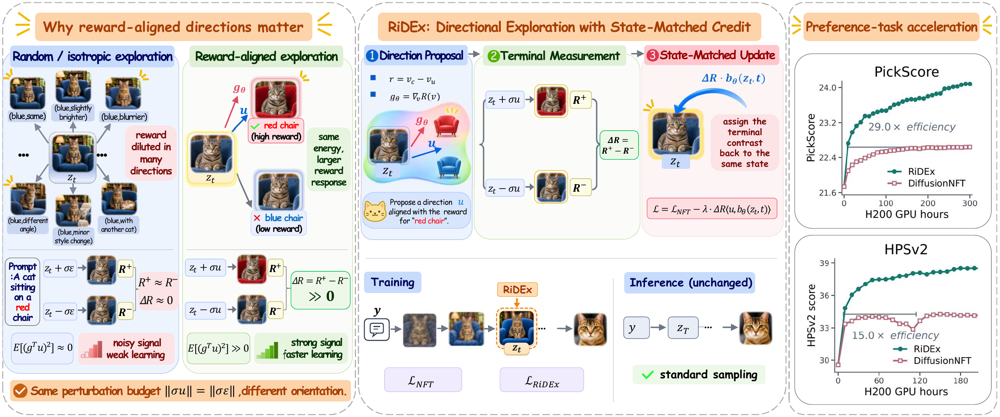
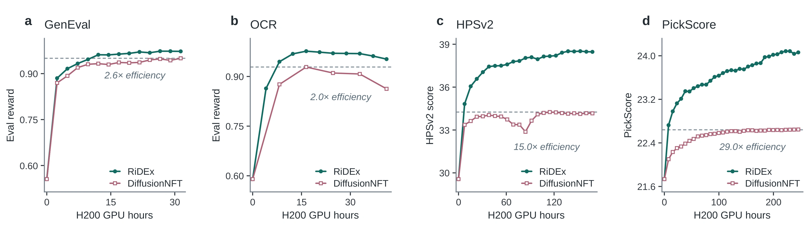

<h1 align="center">RiDEx</h1>
<p align="center"><strong>Reward-Informed Directional Exploration for Diffusion Reinforcement Learning</strong></p>

<p align="center">
  Song Yan<sup>1</sup> · Chenfeng Wang<sup>1,2</sup> · Wei Zhai<sup>1,†</sup> · Xingchen Wang<sup>1</sup> · Tao Zhang<sup>3</sup><br>
  Yawen Shao<sup>1,4</sup> · Shi Pan<sup>5</sup> · Min Li<sup>5,†</sup> · Zheng-Jun Zha<sup>1</sup>
</p>
<p align="center">
  <sup>1</sup> University of Science and Technology of China · <sup>2</sup> Li Auto Inc.<br>
  <sup>3</sup> Huazhong University of Science and Technology · <sup>4</sup> Tongyi Lab<br>
  <sup>5</sup> Xi'an High-tech Research Institute<br>
  <em>† Corresponding authors</em>
</p>

<p align="center">
  <a href="https://arxiv.org/abs/2611.22052"></a>
  <a href="https://gary.ac.cn/RiDEX/"></a>
  <a href="https://gary.ac.cn/RiDEX/#comparisons"></a>
  <a href="#citation"></a>
  <a href="LICENSE"></a>
</p>

## Abstract

Reward-based diffusion post-training updates model parameters from task rewards. While existing approaches improve sampling and policy optimization, they still rely largely on isotropic random perturbations in a high-dimensional latent space for exploration. Such variation often spends the perturbation budget on changes with little influence on the target reward, making exploration inefficient. We study where diffusion models should explore and how to learn from that exploration.

We introduce Reward-Informed Directional Exploration (RiDEx), which concentrates local exploration in reward-relevant subspaces of the denoising velocity field. Conditional residuals or differentiable reward gradients propose the subspace, and equal-and-opposite perturbations at the same generation state measure its terminal reward response. The reward difference supplies signed local supervision in the explored coordinates, while all generated images contribute to global DiffusionNFT learning.

RiDEx thereby couples exploration-space selection with feedback about the changes it produces. On Stable Diffusion 3.5 Medium, RiDEx attains the highest peak rewards among the evaluated methods on four alignment and preference tasks. Its gradient-direction instantiation achieves $15\times$ and $29\times$ target-attainment speedups over DiffusionNFT on HPSv2 and PickScore, measured in H200 GPU hours. Controlled experiments confirm that reward-aligned directions elicit stronger responses at equal perturbation magnitude, and that applying their measured credit improves curve-average reward across all four tasks.

**Which changes to a denoising step actually matter to the reward?** RiDEx starts two trajectories from the same diffusion state and nudges their velocities in opposite directions. Comparing the finished images tells the model which way to move at that state. The reward judges the images, not the proposed direction.

[](assets/main.pdf)

*RiDEx changes how the model explores during training; inference still uses standard sampling.* [Full-resolution figure (PDF)](assets/main.pdf)

## A matched comparison

*Prompt excerpt: “exactly two red apples and one green pear.”* The three models receive the same complete prompt and seed. Base produces two fruits; DiffusionNFT produces three but swaps an apple for a pear. RiDEx gets both counts right in this example.

| Base · SD3.5 Medium | DiffusionNFT | RiDEx |
| :---: | :---: | :---: |
|  |  |  |

The [gallery](https://gary.ac.cn/RiDEX/#comparisons) contains ten selected prompts each for GenEval, OCR, HPSv2 and PickScore. Open any image to compare methods at native resolution. The [manifest](assets/comparison_manifest.json) records prompts, seeds and checkpoints; these examples are qualitative, not a preference win rate.

## How RiDEx learns

1. **Propose a direction.** Use a conditional residual or a differentiable reward gradient to choose a small set of velocity directions worth testing.
2. **Test it at the same state.** Apply opposite perturbations, finish both rollouts, and compare their terminal rewards. Either sign can win; a tie provides no directional preference.
3. **Learn at two levels.** Use the signed difference to supervise the tested velocity direction at its source state. Use all generated images for the global DiffusionNFT update.

## Training results

[](assets/training_comparison.pdf)

On SD3.5 Medium, the [paper](https://arxiv.org/abs/2611.22052) reports that RiDEx needs **1/15 of DiffusionNFT's H200 GPU hours on HPSv2** and **1/29 on PickScore** to reach the respective target scores. This compares compute to reach a score, not the speed of a training step. [View the vector figure (PDF)](assets/training_comparison.pdf).

### HPSv2 epoch timing

On **16 NVIDIA A800 GPUs**, RiDEx took **55.4% less wall time per epoch** than DiffusionNFT in these runs.

| Method | Images per epoch | Mean time per epoch |
| :--- | ---: | ---: |
| DiffusionNFT | 1,152 | 16 min 43 s |
| **RiDEx** | **576** | **7 min 27 s** |

Times are averaged over the first 120 epochs of each run. They include rollout, reward scoring, and parameter updates, but exclude model loading, evaluation, and checkpoint writes. Both runs use HPSv2; the DiffusionNFT run also uses GenEval. The **2.24×** ratio compares epoch duration, not time to a target score.

## Citation

```bibtex
@article{yan2026ridexrewardinformeddirectionalexploration,
  title={RiDEx: Reward-Informed Directional Exploration for Diffusion Reinforcement Learning},
  author={Song Yan and Chenfeng Wang and Wei Zhai and Xingchen Wang and Tao Zhang and Yawen Shao and Shi Pan and Min Li and Zheng-Jun Zha},
  journal={arXiv preprint arXiv:2611.22052},
  year={2026},
  eprint={2611.22052},
  archivePrefix={arXiv},
  primaryClass={cs.LG},
  url={https://arxiv.org/abs/2611.22052},
}
```

## License

Original RiDEx code is licensed under the [MIT License](LICENSE). The bundled fonts retain their respective [OFL notices](assets/fonts/).

[Project page source and local preview](web/README.md)

## Acknowledgments

We thank the authors of [Flow-GRPO](https://github.com/yifan123/flow_grpo) for sharing their diffusion RL codebase and the authors of [DiffusionNFT](https://github.com/NVlabs/DiffusionNFT) for sharing the forward-process training objective and its reference implementation.

```bibtex
@article{liu2025flow,
  title={{Flow-GRPO}: Training Flow Matching Models via Online {RL}},
  author={Liu, Jie and Liu, Gongye and Liang, Jiajun and Li, Yangguang and
          Liu, Jiaheng and Wang, Xintao and Wan, Pengfei and Zhang, Di and Ouyang, Wanli},
  journal={arXiv preprint arXiv:2505.05470},
  year={2025},
  url={https://arxiv.org/abs/2505.05470},
}

@article{zheng2025diffusionnft,
  title={{DiffusionNFT}: Online Diffusion Reinforcement with Forward Process},
  author={Zheng, Kaiwen and Chen, Huayu and Ye, Haotian and Wang, Haoxiang and
          Zhang, Qinsheng and Jiang, Kai and Su, Hang and Ermon, Stefano and
          Zhu, Jun and Liu, Ming-Yu},
  journal={arXiv preprint arXiv:2509.16117},
  year={2025},
  url={https://arxiv.org/abs/2509.16117},
}
```

### MixGRPO license

The HPSv2 training implementation uses a sampler adapted from [MixGRPO](https://github.com/Tencent-Hunyuan/MixGRPO), copyright (c) 2025 Tencent. The sampler is not distributed in this repository yet. Material covered by the [MixGRPO License Terms](licenses/MixGRPO.txt) is limited to academic use and is not covered by RiDEx's MIT license. See the [upstream license](https://github.com/Tencent-Hunyuan/MixGRPO/blob/main/License.txt) for the full terms and third-party notices.
